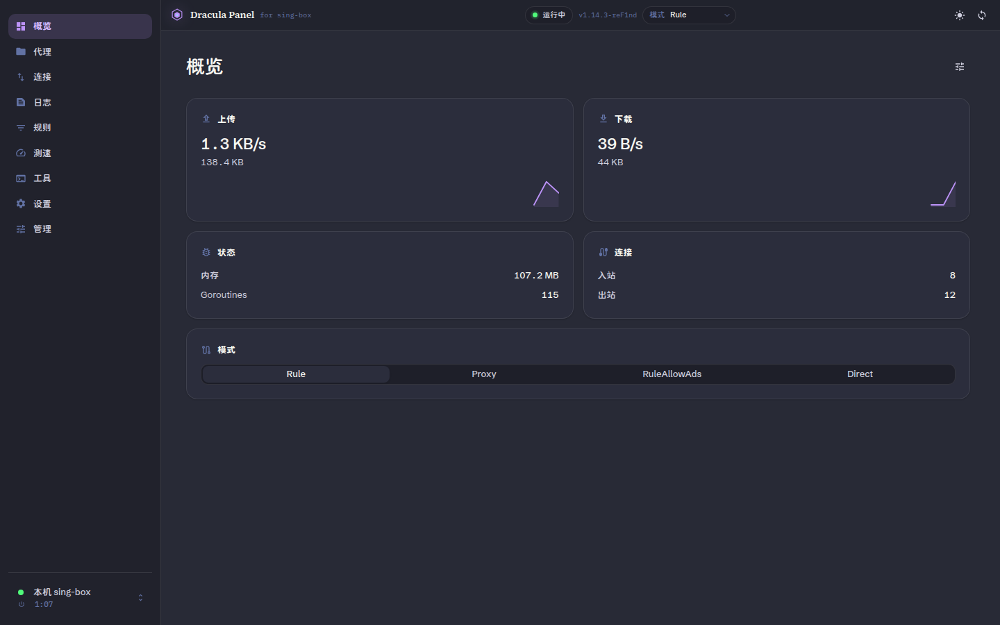
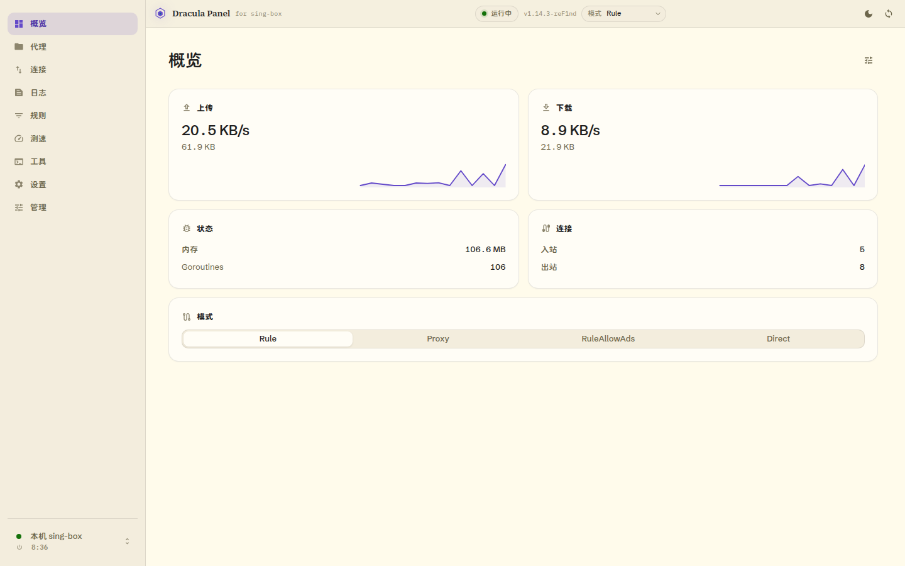
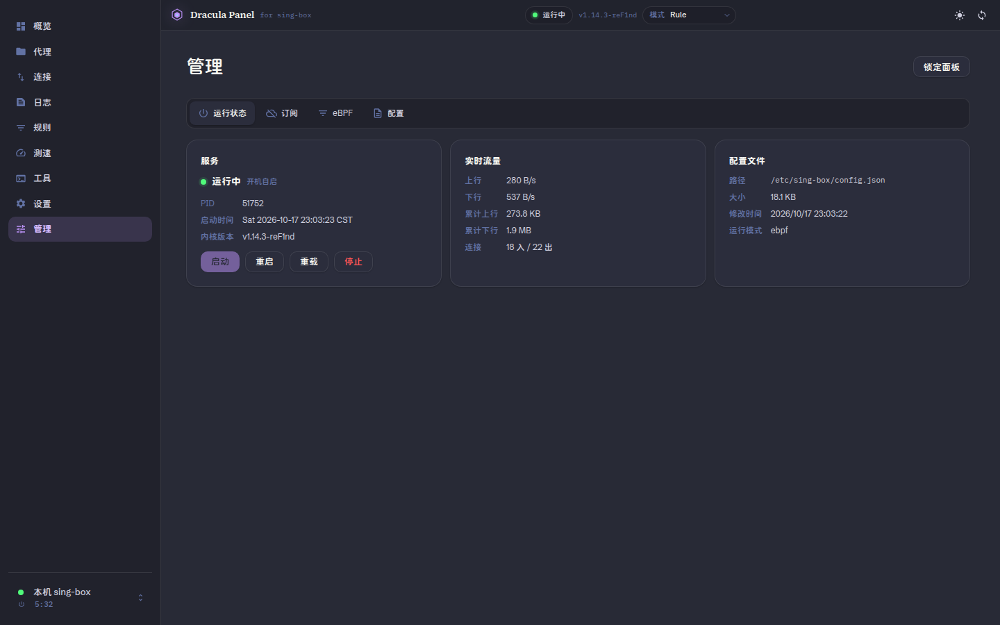
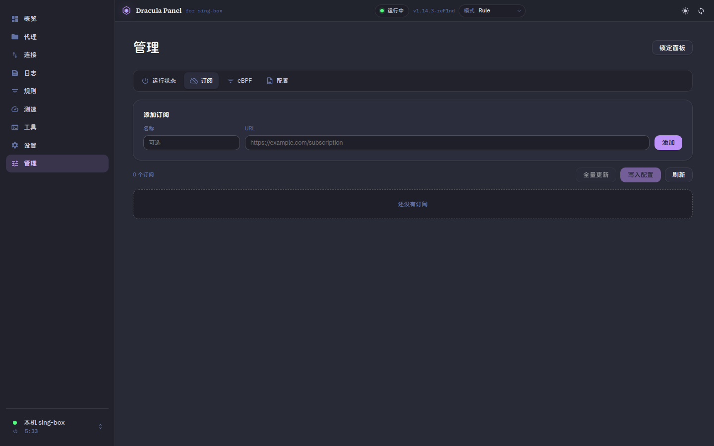
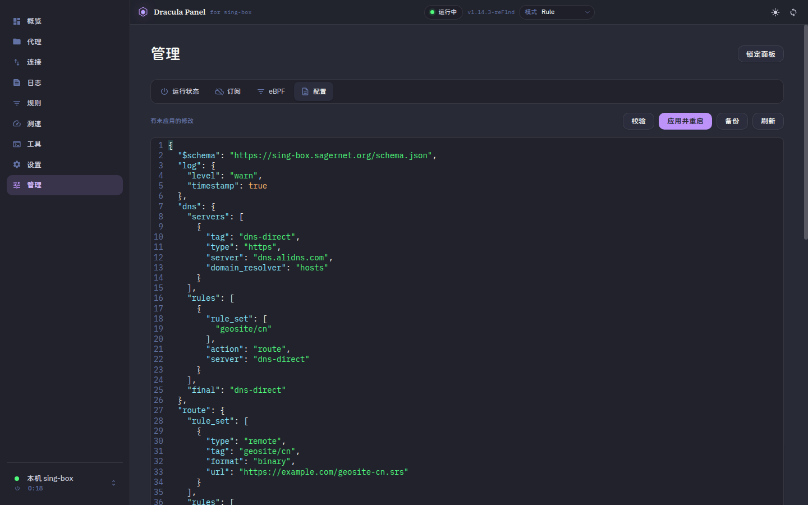
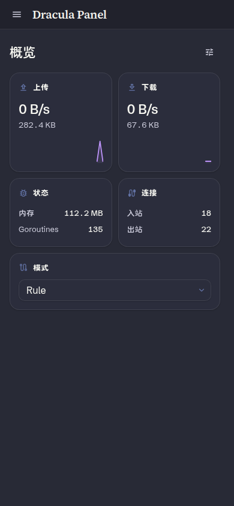
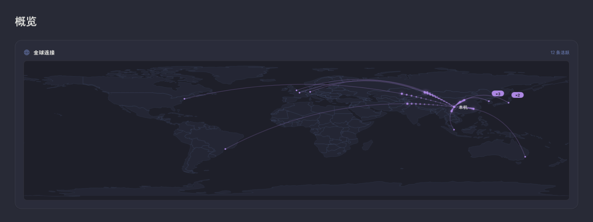
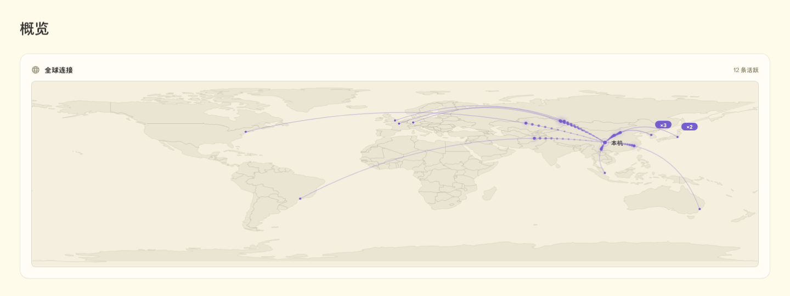

# Dracula Panel for sing-box

**English summary:** An unofficial Dracula/Alucard-themed desktop web UI for
[sing-box](https://sing-box.sagernet.org/). It keeps the upstream native-API
dashboard and adds a local management module (service control, subscriptions,
eBPF policy, JSON config editor) through `sing-box-panel`. One UI entry, one
panel token, and the native API secret is bootstrapped and cached automatically.

> **Unofficial fork.** This project is built on top of
> [SagerNet/sing-box-dashboard](https://github.com/SagerNet/sing-box-dashboard)
> (GPL-3.0). It is not affiliated with or endorsed by SagerNet or the sing-box
> project. See [NOTICE](NOTICE) and [LICENSE](LICENSE).



## 这是什么

一个桌面形态的 sing-box Web 面板：

- 以**官方 sing-box-dashboard 源码**为底版做深度定制，保留 React 19 + Vite +
  TypeScript + Connect RPC 的架构和对原生 gRPC API 的完整封装。
- 全局换成 **Dracula**（暗）/ **Alucard**（亮）主题，覆盖官方页面、管理模块、
  CodeMirror 配置编辑器和图表。
- 增加一个**管理模块**：服务启停/重启/重载、订阅、eBPF 分应用策略、配置编辑
  （校验 → 备份 → 原子替换 → 重启 → 失败回滚），与官方页面同一设计系统，
  没有 iframe。
- **全球连接实时地图**：概览页底部按目标城市聚合实时连接，Canvas 绘制动态
  弧线；GeoIP 只通过本机 panel 的 `/api/geoip` 查询。
- **一个浏览器入口**：`http://127.0.0.1:9096/`。原生 API 仅作为内部 RPC
  (`9091`)，自带 dashboard 已关闭；如果 panel 配置了 `zashboard_dir`，
  zashboard 仍在 `/dash/` 作为可选回退。

## 功能

- **概览 / 代理 / 连接 / 日志 / 规则 / 测速 / 设置 / 管理**，外加官方工具页
- 四模式顶栏下拉：`Rule` / `Proxy` / `RuleAllowAds` / `Direct`，走原生
  `SetClashMode`，切换后立即生效
- 原生 API：节点切换、URLTest、连接流、日志流、实时流量、NetworkQuality/STUN
- 规则页从**实时配置**派生（原生 API 没有规则 RPC），展示 route/DNS 规则、
  规则集、final
- 连接表窗口化虚拟滚动（不再截断 500 条）
- 全球连接地图：GeoIP 城市聚合、动态贝塞尔弧线、30 条上限、亮暗主题跟随；
  无连接/缺少 GeoIP 数据库时优雅降级
- `Ctrl+1…8` 切换八个主页面；主题/强调色/最后页面/管理标签页持久化
- 44px 顶栏：logo、运行状态灯、版本、模式下拉、亮暗、刷新
- 窄屏自动降级：侧栏抽屉、模式选择器降级为下拉、无横向溢出

## 功能截图

> 前六张截图来自已经验收的本机实例；最后两张是 `TrafficMap` 组件的合成连接预览
> （不是线上流量），用于展示地图布局。订阅流量/自动更新、系统日志、集成卡和
> 真实地图需要安装 `sing-box-panel 0.1.0-8` 和新版 UI 后显示。

| | |
| --- | --- |
|  |  |
| 概览 · Dracula | 概览 · Alucard |
|  |  |
| 管理 · 运行状态 | 管理 · 订阅 |
|  |  |
| 管理 · 配置编辑器 | 窄屏布局 |
|  |  |
| 全球连接地图预览 · Dracula（合成数据） | 全球连接地图预览 · Alucard（合成数据） |

## 架构

```text
Browser
  │
  ▼
127.0.0.1:9096  Dracula Panel（React 静态产物，由 sing-box-panel 的 ui_dir 提供）
  ├─ /api/*    sing-box-panel 管理 API（同源，X-Panel-Token）
  ├─ 127.0.0.1:9091  sing-box 原生 API（Connect / gRPC-Web，仅 RPC，dashboard 关闭）
  └─ 127.0.0.1:9090  Clash API（zashboard 回退和面板遗留节点接口）
```

### 为什么 UI 由 panel `ui_dir` 提供

构建产物放在 `/usr/local/share/sing-box-panel-ui`，由 `sing-box-panel` 在
9096 提供，而不是放在 `/var/lib/sing-box/dashboard` 由原生 API 的
`/dashboard/` 提供：

- 管理 API 与 UI 同源，不需要给 panel 再加 CORS；
- 原生 API 支持 CORS 白名单，9096 可以安全访问 9091；
- 最终只有一个浏览器入口（9096），9091 只做内部 RPC；
- 如果 panel 配置了 `zashboard_dir`，zashboard 继续在 `/dash/` 作为回退；
  `install.sh` 不修改该字段。

原生 API 的 `services.api` 显式配置了
`access_control_allow_origin = ["http://127.0.0.1:9096", "http://localhost:9096"]`，
没有 `*` 兜底；`dashboard.enabled = false`。

### 登录与密钥引导

1. 登录只需 **panel token**（`/var/lib/sing-box-panel/token`）。
2. 校验后从 `/api/config` 读取一次完整配置，提取 `services[type=api]` 的
   secret 和端口，写入 dashboard 的 server 列表并连接原生 API。
3. 配置的 mtime **和字节数**会一起缓存：普通刷新只请求 `/api/state`，不重复
   拉全量配置；只有配置真的变化后才重新同步一次。配置里的 `//`、`/* */`
   注释和 trailing comma 会被正确解析（sing-box 接受它们）。
4. 核心停止时，登录闸门**先**显示 Dracula 风格的服务恢复界面，再尝试同步
   原生 API；因此即使配置暂时读不出来，启动/重启按钮也不会被错误页挡住。
   配置应用/重启后 `DaemonApi.reconnectNow()` 自动恢复数据流，不整页刷新。
5. 点击“锁定面板”会清除 panel token、原生 API secret 缓存和托管服务器条目，
   并让其他已打开的面板标签页刷新回登录页。它防的是误操作和他人顺手使用
   当前浏览器，不是本机同用户进程或恶意扩展的安全边界。

## 页面与快捷键

| Page | 说明 |
| --- | --- |
| 概览 | 流量、内存、连接数、四模式卡片、全球连接地图 |
| 代理 | 策略组、节点切换、延迟 |
| 连接 | 实时连接、搜索、关闭、虚拟滚动 |
| 日志 | 原生日志流、级别过滤、搜索 |
| 规则 | 配置派生的路由/DNS 规则、规则集、final |
| 测速 | 分组 URLTest、网络质量/STUN 入口 |
| 设置 | 偏好、服务器、上游链接、非官方声明 |
| 管理 | 运行状态、订阅、eBPF、配置 |

`Ctrl+1` 概览 · `Ctrl+2` 代理 · `Ctrl+3` 连接 · `Ctrl+4` 日志 ·
`Ctrl+5` 规则 · `Ctrl+6` 测速 · `Ctrl+7` 设置 · `Ctrl+8` 管理

## 管理模块

- **运行状态**：启动/停止/重启/重载（panel API），PID/启动时间/配置路径，
  原生实时流量；显示配置读取错误、`journalctl -u sing-box` 系统日志、
  Clash API/密钥和按可用性显示的备用入口（zashboard 自动填密钥、MetaCubeXD、
  官方 dashboard）。核心停止时该页面仍然可用。
- **订阅**：添加 URL、全量更新、单条更新、写入配置、删除；支持按订阅设置
  自动更新间隔，展示 `Subscription-Userinfo` 的已用流量/总量/到期时间，
  以及当前托管节点、托管组、未支持协议和逐条更新失败信息。写入仍走 panel
  的校验/备份/重启/回滚事务。
- **eBPF**：策略模式、应用列表、UID 选择、能力预检；预检结果按
  PASS/FAIL/UNKNOWN 和 findings 展示，应用行显示可执行文件和运行进程数。
- **配置**：CodeMirror JSON5 编辑器（Dracula 语法色）、校验、应用并重启、
  备份列表、恢复和下载。应用失败由 panel 自动回滚。配置可以带注释/trailing
  comma，panel 与原生 API 都按 sing-box 实际支持的子集解析。

管理模块目前只提供中文界面；上游 dashboard 页面仍跟随其语言设置。上述
panel 侧能力和全球连接地图需要配套的 `sing-box-panel 0.1.0-8`，包括
`POST /api/subscriptions/<id>/schedule`、`GET /api/subscriptions/managed`、
`GET /api/config/backups/<name>`、`GET /api/geoip?ip=...`、`/api/logs` 和
`/api/state` 的可用性/`egress_ip` 字段；仍在使用 0.1.0-6 时新控件会收到
404，其余管理功能不受影响。

## 主题

- 暗色：Dracula（`#282a36` / `#44475a` / `#f8f8f2` / `#6272a4` / `#bd93f9` / `#8be9fd`）
- 亮色：Alucard（`#fffbeb` / `#1f1f1f` / `#6c664b` / `#cfcfde` / `#644ac9`）
- CodeMirror：属性/字符串/数字/布尔/注释/错误分别映射到 cyan/green/yellow/
  orange/comment/red
- PWA / Service Worker 已关闭，升级/回滚不会被旧缓存挡住

更多截图见 [artifacts/README.md](artifacts/README.md)（含验收记录）。

## 环境要求

- Linux + systemd；基础管理功能在 CachyOS（Arch 系）的
  `sing-box-panel 0.1.0-6` + `sing-box v1.14.3-reF1nd` 上验证；订阅/备份/
  GeoIP 端点来自本地构建的 `sing-box-panel 0.1.0-8`（已通过 dry-run 集成
  测试，需单独重新打包安装）
- sing-box 1.14+，支持 `services.api` / Connect API
- 面板需要 `python-maxminddb`；GeoIP 城市库推荐由 `deploy/install.sh`
  下载的 DB-IP City Lite（也可配置自备的 GeoLite2/DB-IP mmdb）
- Node.js 22+（验证使用 24.22.0）、pnpm 11、Git
- 已安装 `sing-box-panel`，并准备好它的 `--config` systemd drop-in
- `deploy/install.sh` 假定 panel 监听 `127.0.0.1:9096`、二进制位于
  `/usr/bin/sing-box-panel`、UI 目录为
  `/usr/local/share/sing-box-panel-ui`；不同发行版/目录结构请先阅读脚本再运行

## 构建

```bash
git clone --recursive https://github.com/emoeem/dracula-panel-for-sing-box.git
cd dracula-panel-for-sing-box
# 如果克隆时没有 --recursive：
git submodule update --init --depth 1

npx --yes pnpm@11.13.0 install --frozen-lockfile --trust-lockfile
npx --yes pnpm@11.13.0 generate   # protobuf + 图标 + 终端主题
./node_modules/.bin/tsc -b
./node_modules/.bin/vite build
```

> `--trust-lockfile` 用于跳过 pnpm 11 对 lockfile 每个条目的供应链元数据校验；
> 仓库使用的是上游固定 lockfile。网络条件好时可以省略。

`src/gen/` 和 `src/lib/terminalThemes.generated.ts` 是生成文件，按上游约定
不提交；`pnpm generate` 会生成它们。

## 部署

```bash
sudo ./deploy/install.sh                  # 配置 + UI + GeoIP 数据
sudo ./deploy/install.sh --ui-only        # 只更新 UI，不改配置、不重启核心
sudo ./deploy/install.sh --rotate-secret  # 显式轮换原生 API secret
sudo ./deploy/install.sh --refresh-geoip  # 重新下载 DB-IP 城市库
```

脚本会（一次 sudo）：

1. 备份 `/etc/sing-box/config.json`（时间戳，600）；
2. 添加/更新 `services[type=api]`：`127.0.0.1:9091`、9096-only CORS 白名单、
   私有网络、dashboard 关闭。**默认保留已有 secret**，只有首次安装或显式
   `--rotate-secret` 才生成新的；secret 在生成后不会输出；
3. 确认 panel 配置（`/etc/sing-box-panel/panel.json`）和 systemd drop-in，
   改动前先备份；
4. 安装 `sing-box-config-perm.path`（配置变更后 `chmod 600`，并用
   `stat -c %a` 复核），改动前先备份；
5. 把旧 UI 移到 `...legacy-<timestamp>`，在新目录复制完成后一次性切换；
6. 下载 DB-IP City Lite 到 `/usr/share/GeoIP/dbip-city-lite.mmdb`，校验
   SHA-256 后解压；下载/校验失败只警告，`/api/geoip` 返回 503，不影响其余
   安装；
7. 重启服务并等待就绪（失败自动回滚 config、panel 配置、drop-in、path unit
   和 UI）。

配置可以包含 `//`、`/* */` 注释和 trailing comma；安装器会先把它们归一化
为严格 JSON 再写入。**重写后的 `config.json` 不再保留注释**，原文件保存在
`/etc/sing-box/backups/config.json.bak.*-dracula`。`--ui-only` 完全跳过配置
步骤，适合只更新前端。

脚本不会修改 `/usr/bin` 或 `/usr/share` 下由包管理的文件；GeoIP 数据写入
`/usr/share/GeoIP`。

> 订阅自动更新/Userinfo、备份下载和全球连接地图需要配套的
> `sing-box-panel 0.1.0-8`；
> `deploy/install.sh` 只部署 UI，不构建或安装面板包。仍使用 0.1.0-6 时，
> 这些新控件会收到 404，UI 会显示错误但不会影响其他管理功能。

### 首次登录

```bash
sudo cat /var/lib/sing-box-panel/token
```

打开 <http://127.0.0.1:9096/>，输入 token。原生 API secret 会自动引导并缓存，
不需要再输第二个密钥。

## 安全

- panel API 与 UI 同源，使用 `X-Panel-Token`；
- 原生 API 只监听 `127.0.0.1:9091`，CORS 白名单仅 9096/localhost:9096；
- 9091 的 dashboard 已关闭（`/dashboard/` = 404）；
- panel 写配置时是 0644，`sing-box-config-perm.path` 会立即恢复 600 并复核；
- 静态产物不含任何 token/secret；登录后 secret 存在本机 localStorage；
- **仅支持本机使用**：入口固定为 `http://127.0.0.1:9096`（或
  `http://localhost:9096`），原生 API 地址写死为 `127.0.0.1:9091`，CORS
  也只允许这两个 Origin。从局域网 IP、反向代理或 HTTPS 打开时原生连接会
  失败，这是设计约束，不是待配置项；
- 如果 `services.api.secret` 为空，管理页会显示警告：sing-box 会关闭原生
  API 鉴权，本机其他进程可直接控制核心。正常安装会生成非空 secret；
- 下载的配置备份包含 `services.api` secret、Clash secret 和出站密码，应按
  敏感文件保存；它和当前配置一样只通过 panel token 鉴权；
- **威胁模型**：panel 以 root 身份写配置、重启服务，登录令牌和原生 secret
  都存在浏览器 localStorage。锁定面板会清 token、API 缓存和托管服务器
  条目，并让其他标签页刷新回登录页，但它只防误操作/他人顺手使用当前浏览器，
  **不防本机同用户进程、恶意浏览器扩展或 XSS**。需要更强隔离时，应使用独立
  的桌面用户/浏览器 profile；
- 仓库中的验收截图来自真实本机实例，**部分截图包含本地测试域名/流量**；
  如果要把本仓库公开，请先审阅/脱敏 `artifacts/screenshots/`。

## 全球连接地图与 GeoIP

- 概览页底部的“全球连接”卡片从 `api.connections` 快照对比出新建/关闭连接，
  取 `connection.destination` 的 IP（域名或无 IP 时跳过，不做 DNS 解析），
  通过本机 panel 的 `GET /api/geoip?ip=...` 得到城市坐标。浏览器不会向
  panel 以外的地址发地理查询。
- 目标按 1° 网格聚类，同一格合并为一条弧线并显示 `×N`；并发弧线最多 30 条，
  超出淘汰最旧。前端有 500 条 LRU 和 pending 去重，300+ 连接不会逐连接重复
  查询同一 IP。
- 本机原点优先级：panel 配置/探测的 `egress_ip` → 第一个连接的
  `source` 公网 IP → 成都回退（见代码中的 TODO）。
- **数据源**：DB-IP City Lite（MMDB，CC BY 4.0）。上游为
  <https://db-ip.com>；安装脚本从版本固定的 jsDelivr/npm 镜像
  `dbip-city-lite@1.0.18` 下载 `.mmdb.gz`，校验 `.gz` 和 `.mmdb` 的
  SHA-256 后解压到 `/usr/share/GeoIP/dbip-city-lite.mmdb`。
  Attribution: **IP Geolocation by DB-IP (https://db-ip.com)**，许可：
  <https://creativecommons.org/licenses/by/4.0/>。
- panel 默认先找 `/usr/share/GeoIP/GeoLite2-City.mmdb`，再回退到
  `/usr/share/GeoIP/dbip-city-lite.mmdb`；可以用 panel.json 的
  `geoip_database` 指定自备库。需要 `python-maxminddb`。
- `egress_ip` 是静态出口 IP；`egress_ip_probe_url` 是**可选**的探测 URL
  （默认空，不产生外部请求）。如果启用，panel 只向该 URL 发一次 GET 并缓存，
  不包含任何连接目的地信息。
- GeoIP 查询只在 panel 进程内存中完成：不记录查询 IP、不落盘、不向第三方
  发送。缺库/缺依赖时 `/api/geoip` 返回 503，卡片显示一次
  `missing GeoIP database, see README`，不会逐连接重试。

## 验收

真实环境（非 mock）验收结果摘要：

| 项目 | 结果 |
| --- | --- |
| 四个自定义模式 | 顶栏切换，Clash API 逐一复核，已复位 Rule |
| 重启 / eBPF 应用 / 停止 / 启动 | 33/33；PID 变化，页面未整页刷新，RPC 自动恢复 |
| 配置编辑器应用/恢复 | `log.level` warn → info → warn，服务健康，无整页刷新 |
| 订阅 | 本地 mock 源添加/更新/删除，已删除；未写入测试节点 |
| secret 引导缓存 | 首次登录读一次完整配置；刷新只请求 `/api/state` |
| 连接虚拟滚动 | 56 条连接仅渲染 14 个 DOM 行 |
| CORS / 9091 | 9096 允许，非白名单无 ACAO；`/dashboard/` 404 |
| 配置权限 | 600；模拟 644 后被 path unit 复核回 600 |
| 回滚演练 | UI + 配置回滚均通过并恢复 |
| 包完整性 | `pacman -Qkk sing-box-panel`：51 文件，0 变化 |

完整截图和记录见 [artifacts/README.md](artifacts/README.md)。

## 回滚

完整步骤见 [DEPLOYMENT.md](DEPLOYMENT.md#rollback)。核心是：

```bash
# 恢复 sing-box 配置（移除 9091 API）
sudo cp -a /etc/sing-box/backups/config.json.bak.<timestamp>-dracula /etc/sing-box/config.json
sudo chmod 600 /etc/sing-box/config.json
sudo systemctl restart sing-box

# 恢复旧 UI
sudo rm -rf /usr/local/share/sing-box-panel-ui
sudo mv /usr/local/share/sing-box-panel-ui.legacy-<timestamp> /usr/local/share/sing-box-panel-ui
sudo systemctl restart sing-box-panel
```

zashboard 回退入口 `http://127.0.0.1:9096/dash/` 取决于 panel 的
`zashboard_dir` 配置；`install.sh` 不设置该字段。如果 panel 配置把
`zashboard_dir` 指向一个空目录（例如 `no-zashboard`），该链接会 404，不影响
Dracula UI 本身。

## 限制

- 原生 API 没有规则 RPC；规则页只能从实时配置派生，不是“内核实际命中规则”的
  实时日志。
- 上游仅桌面宿主可用的页面（崩溃/功耗/OOM 报告等）在 Web 构建中仍保持
  host-only 行为。
- `Global` 模式保留在配置中供 zashboard 回退使用，但新 UI 只展示四个目标模式。
- 订阅的“写入配置”使用与配置应用相同的 panel 事务；验收中未把测试节点写入
  真实配置。
- 全球连接地图不做 DNS 解析；只有 `destination` 是公网 IP 的连接会出现弧线，
  内网/保留地址或无 IP 的连接会被跳过。缺少 mmdb 时地图只显示提示。
- `deploy/install.sh` 是针对本机 systemd/panel 布局的部署脚本，不是通用安装器。

## 目录

```text
├── src/                 React 源码（官方 dashboard + 新增管理/规则/测速/顶栏）
├── public/              图标等静态资源
├── proto/               StartedService protobuf
├── vendor/              iTerm2 色板 submodule（生成终端主题）
├── artifacts/           验收脚本、截图、验收记录
├── deploy/              一次性部署脚本、回滚演练脚本
├── NOTICE               上游/主题/非官方声明
├── LICENSE              GPL-3.0
├── README-UPSTREAM.md   上游原始 README（保留）
└── DEPLOYMENT.md        构建、部署、安全、回滚细节
```

## 许可证与致谢

- 本项目基于 [SagerNet/sing-box-dashboard](https://github.com/SagerNet/sing-box-dashboard)，
  遵循 **GNU GPL v3.0**；见 [LICENSE](LICENSE) 与 [NOTICE](NOTICE)。
- Dracula / Alucard 色板来自 [Dracula Theme](https://github.com/dracula/dracula-theme)。
- 图标来自 Material Design Icons（Apache-2.0）。
- 上游许可证明确要求衍生作品不得使用原名或暗示官方关联；本项目使用
  “Dracula Panel for sing-box” 并明确声明非官方。
